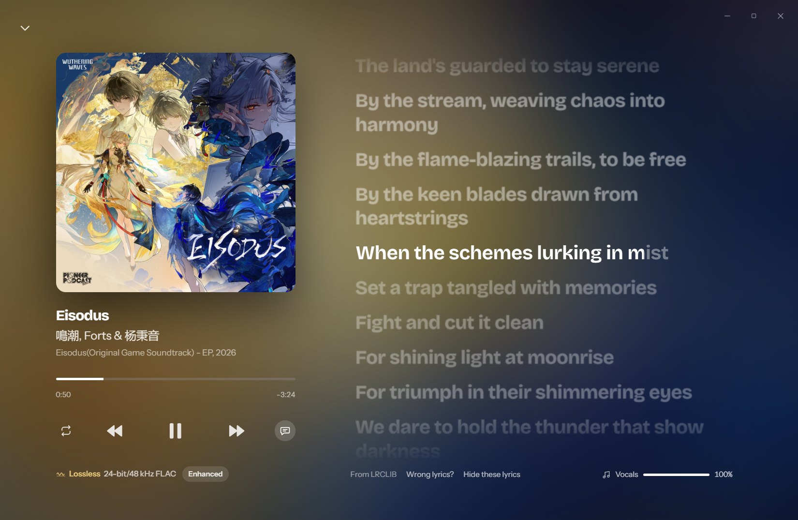

<p align="center"></p>

# Cadence

A music player for the files you own. Cadence plays FLAC and other lossless formats bit-perfect, keeps albums gapless,
follows every word of the lyrics, and turns your library into mixes by how the songs sound.

**Website:** https://cadence.akbarharyadi.com · **Download:** [latest release](https://github.com/akbarharyadi/cadence/releases/latest)
for Windows, macOS and Linux.


## Features

**Sound**
- Lossless playback of FLAC, ALAC, WAV and AIFF (plus MP3, AAC and Ogg Vorbis), decoded to 32-bit float without loss.
- **Direct output** (Windows, WASAPI exclusive): each song goes to the device at its own sample rate, past the Windows
  mixer. With processing off it is bit-perfect, and Cadence says so.
- Gapless playback; optional crossfade between albums.
- **Sound Check**: ReplayGain 2.0 loudness (tags or Cadence's own EBU R128 measurement), by album or by song.
- **Tone per song**: gentle loudness compensation and a per-song "Smart EQ" from each song's measured tonal balance.
- 10-band graphic and parametric equalizer with automatic headroom; import AutoEq / Equalizer APO headphone profiles.
- Crossfeed for headphones (bs2b) and high-quality FFT resampling when the device runs at another rate.
- A live signal path that shows every step between the file and your speakers.

**Listening**
- Synced lyrics with a word-by-word karaoke sweep and a **Vocals** slider to sing along. Lyrics come from the file, a
  `.lrc` next to it, LRCLIB, the AI DJ, or you; once found they're kept.
- **Sounds like**: every song is analysed once on your computer (bliss: tempo, timbre, loudness, harmony) for sound
  radio, "songs that sound like this" and automatic mixes.
- **AI DJ** (optional, your own key; Z.ai GLM by default, any OpenAI-compatible service): ask for music in your own
  words, daily mixes from your listening, and new music to buy.
- Playlists and smart playlists, tag editing, ListenBrainz scrobbling, media keys and the Windows media overlay, a
  mini player and the system tray.



## Install

Download the installer for your system from the [latest release](https://github.com/akbarharyadi/cadence/releases/latest):

| System | File |
|---|---|
| Windows 10/11 | `Cadence_<version>_x64-setup.exe` |
| macOS (Apple Silicon and Intel) | `Cadence_<version>_universal.dmg` (unsigned: the first time, right-click the app and choose **Open**) |
| Linux | `.AppImage` (any distro) or `.deb` (Debian/Ubuntu) |

## Build from source

You need Rust (stable), Node 20+ and pnpm. On Linux also the Tauri prerequisites
(`libwebkit2gtk-4.1-dev libappindicator3-dev librsvg2-dev libasound2-dev libdbus-1-dev`).

```sh
pnpm install
pnpm tauri dev      # run in development (Vite on port 1430)
pnpm tauri build    # make installers in src-tauri/target/release/bundle
```

Releases are built by GitHub Actions ([`.github/workflows/release.yml`](.github/workflows/release.yml)) when a `v*` tag is pushed.

## How it works

| Part | Where |
|---|---|
| Engine: queue, gapless, ring buffer, crossfade, output | `src-tauri/src/audio/mod.rs`, `output.rs`, `exclusive.rs` |
| Decoding (Symphonia) | `src-tauri/src/audio/source.rs` |
| Loudness (ReplayGain 2.0 / EBU R128), tone, EQ, crossfeed, vocal reduction | `src-tauri/src/audio/` |
| Library scan, tags (lofty), artwork, folder watching | `src-tauri/src/library.rs`, `jobs.rs` |
| Sound analysis and mixes (bliss) | `src-tauri/src/sonic.rs` |
| Lyrics, AI DJ, catalogue lookups | `src-tauri/src/lyrics.rs`, `ai.rs`, `catalog.rs` |
| Interface (Svelte 5) | `src/lib` |

A worker thread decodes ahead into a lock-free ring buffer. The device callback only copies samples out, fades and
applies volume, so the UI and the disk never cause dropouts. Data (settings, library cache, artwork, lyrics) lives in
the app data folder (`%APPDATA%\com.cadence.player` on Windows). API keys and tokens are stored in the system's
credential store, never in files.

Background on the design: [docs/research-features-and-ai.md](docs/research-features-and-ai.md).

## Privacy

No account, no tracking. Sound analysis runs locally. Lyrics lookups send the artist and title to LRCLIB. The AI DJ is
off until you add a key, and Settings shows exactly what it would send.

## License

[GNU GPL v3](LICENSE). Cadence uses [bliss-audio](https://github.com/Polochon-street/bliss-rs) (GPL-3.0) and many
other open-source crates and packages; see `src-tauri/Cargo.toml` and `package.json`.
