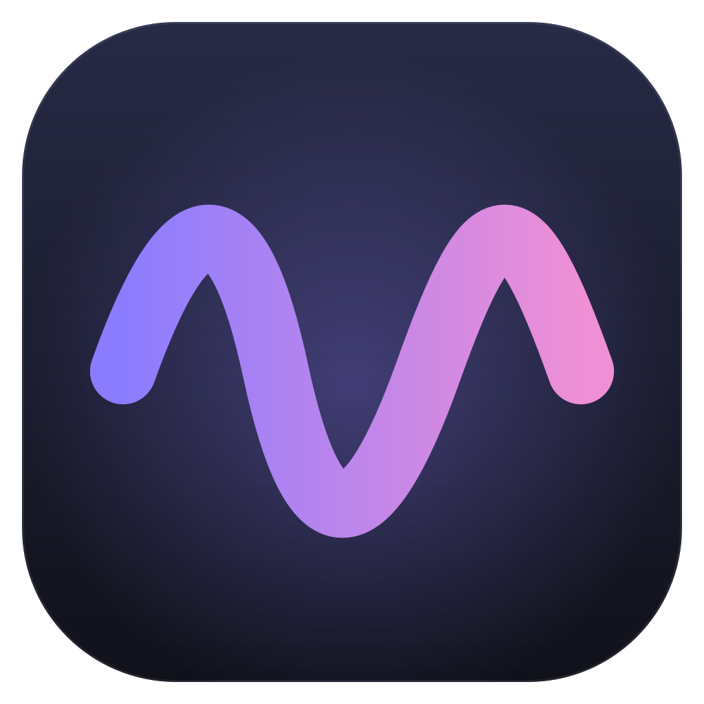
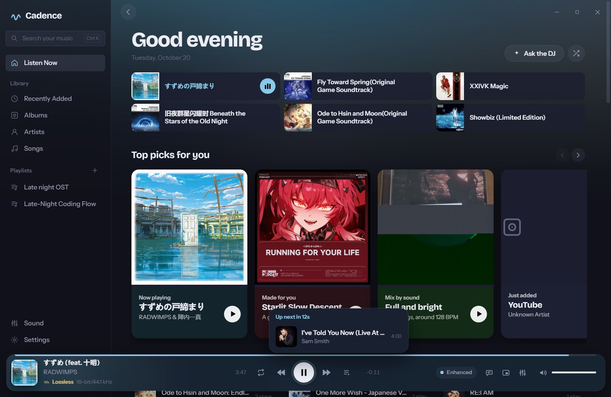
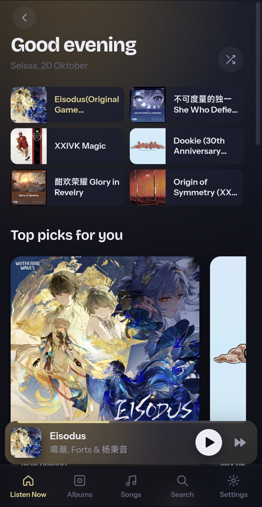
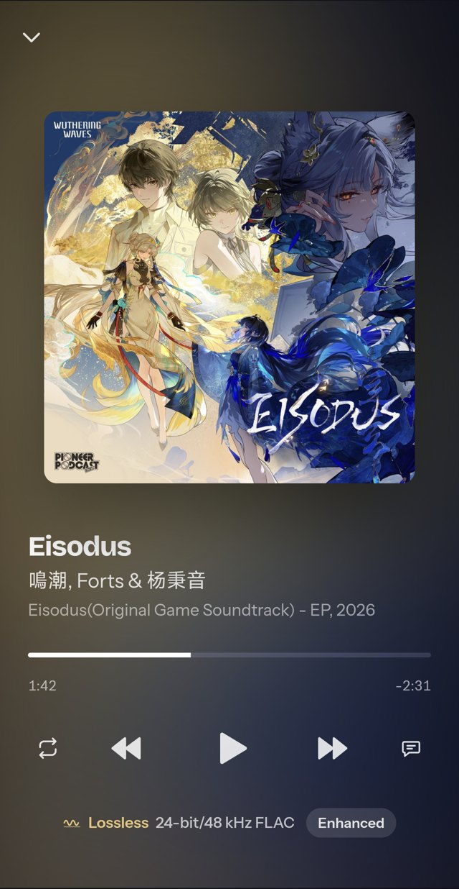

<p align="center"></p>

<h1 align="center">Cadence</h1>

<p align="center">
  A lossless music player for the files you own.<br />
  Bit-perfect output, gapless albums, synced karaoke lyrics, and mixes by how your music sounds.
</p>

<p align="center">
  <a href="https://github.com/akbarharyadi/cadence/releases/latest"></a>
  <a href="https://github.com/akbarharyadi/cadence/releases"></a>
  <a href="https://github.com/akbarharyadi/cadence/actions/workflows/release.yml"></a>
  <a href="LICENSE"></a>
  
</p>

<p align="center">
  <a href="https://cadence.akbarharyadi.com"><b>Website</b></a> ·
  <a href="https://github.com/akbarharyadi/cadence/releases/latest"><b>Download</b></a> ·
  <a href="https://github.com/akbarharyadi/cadence/issues"><b>Report a problem</b></a>
</p>



## Contents

- [Features](#features)
- [Sound quality on each system](#sound-quality-on-each-system)
- [Install](#install)
- [Build from source](#build-from-source)
- [Architecture](#architecture)
- [Privacy](#privacy)
- [Contributing](#contributing)
- [License](#license)

## Features

### Sound

- **Lossless playback** of FLAC, ALAC, WAV and AIFF (plus MP3, AAC and Ogg Vorbis), up to 32-bit / 384 kHz, decoded to
  32-bit float.
- **Direct output**: each song reaches the device at its own sample rate, past the system mixer. With processing off,
  playback is bit-perfect and Cadence labels it so.
- **Gapless** albums, with optional crossfade between albums.
- **Sound Check**: ReplayGain 2.0 loudness from tags or Cadence's own EBU R128 measurement, by album or by song.
- **Tone per song**: gentle loudness compensation and a per-song Smart EQ from each song's measured tonal balance.
- **Equalizer**: 10-band graphic and parametric, automatic headroom, and AutoEq / Equalizer APO headphone profiles.
- **Crossfeed** for headphones (bs2b) and high-quality FFT resampling when the device runs at another rate.
- **Signal path**: a live view of every step between the file and your speakers.

### Listening

- **Synced lyrics** with a word-by-word karaoke sweep and a **Vocals** slider for singing along. Lyrics come from the
  file, a `.lrc` next to it, LRCLIB, the AI DJ, or you, and are kept once found.
- **Sounds like**: every song is analysed once, locally ([bliss](https://github.com/Polochon-street/bliss-rs): tempo,
  timbre, loudness, harmony), for sound radio, similar songs and automatic mixes.
- **AI DJ** (optional, with your own key; Z.ai GLM by default, or any OpenAI-compatible service): requests in your own
  words, daily mixes from your listening, and new music to buy.
- **Listen Now**: recent albums, top picks, mixes for the day, what's on repeat and what you haven't played in a while.
- **Player**: full-width seek bar, lists of the previous and next songs, a mini player and the system tray.
- **Updates itself**: checks GitHub for new versions, downloads them in the background and installs on restart
  (signed, so only genuine releases install). On Android it downloads the new APK and opens the installer.
- **Fix song info**: for downloads named "Artist - Title", pick the right match from the iTunes catalogue and
  Cadence writes the title, artist, album, year and cover into the file (or does it by itself when they play).
- **Change cover**: pick an album cover from iTunes or Deezer (or an image file); it's shown at once and written
  into the songs' files.
- **Artist pictures**: choose a photo from the online catalogue (Deezer), one of the artist's album covers or your
  own image.
- **Skip songs** you don't want in rotation (or every instrumental and karaoke version): they stay in the library but
  are left out when albums, playlists, mixes and shuffles play.
- Playlists and smart playlists, tag editing, ListenBrainz scrobbling, and media keys with the system media controls.

### Android

- The same library, Sound Check and lossless decoding on your phone, in a layout made for one hand.
- Playback continues with the screen off; control it from the lock screen, the notification, Bluetooth buttons or the
  media island.
- A home screen widget with the cover, the song's quality and play controls.

<p align="center">
  
  &nbsp;
  
</p>

## Sound quality on each system

Each operating system mixes audio differently, so Direct output uses the most direct route each one offers:

| System | Direct output | What it means |
|---|---|---|
| Windows 10/11 | WASAPI exclusive mode | Straight to the device at the song's rate and bit depth, past the Windows mixer. |
| macOS | Device follows the song | The output device is switched to each song's sample rate, so Core Audio never resamples. |
| Linux | ALSA `hw:` device | Plays to the sound card directly, around PulseAudio / PipeWire; USB DACs are preferred. Falls back to shared mode while another app holds the card. |
| Android 8+ | — | 32-bit float to AAudio at the phone's own rate (Android always mixes). |

Bit-perfect playback needs Direct output on, with Sound Check, the equalizer and crossfeed off and the volume at 100%.
The signal path shows a gold **Bit-perfect** label when that holds.

## Install

Download the file for your system from the [latest release](https://github.com/akbarharyadi/cadence/releases/latest):

| System | File | Notes |
|---|---|---|
| Windows 10/11 (64-bit) | `Cadence_<version>_x64-setup.exe` | `.msi` also available. |
| macOS (Apple Silicon and Intel) | `Cadence_<version>_universal.dmg` | Not signed by Apple yet: the first time, right-click the app and choose **Open**. |
| Linux | `Cadence_<version>_amd64.AppImage` | Any distribution (make it executable). `.deb` and `.rpm` also available. |
| Android 8+ (64-bit ARM) | `Cadence_<version>_android-arm64.apk` | Allow installs from your browser or file manager when asked. |

## Build from source

Requirements: Rust (stable), Node.js 20+ and pnpm. On Linux, also the Tauri prerequisites:

```sh
sudo apt install libwebkit2gtk-4.1-dev libappindicator3-dev librsvg2-dev libasound2-dev libdbus-1-dev pkg-config
```

Desktop:

```sh
pnpm install
pnpm tauri dev      # development build (Vite on port 1430)
pnpm tauri build    # installers in src-tauri/target/release/bundle
```

Android (needs the Android SDK and NDK, `ANDROID_HOME` and `NDK_HOME`):

```sh
pnpm tauri android build --apk --target aarch64   # macOS / Linux
scripts/android-build.sh                          # Windows without Developer Mode
```

Release APKs are signed with the keystore named in `src-tauri/gen/android/keystore.properties`
(`storeFile`, `password`, `keyAlias`; never committed), or the `CADENCE_KEYSTORE`, `CADENCE_KEYSTORE_PASSWORD` and
`CADENCE_KEY_ALIAS` environment variables.

Updates: release builds are signed for the in-app updater with the key in the
`TAURI_SIGNING_PRIVATE_KEY` / `TAURI_SIGNING_PRIVATE_KEY_PASSWORD` environment variables (repository secrets in CI).
Desktop apps install updates from `latest.json` on the latest release; Android downloads the new APK and opens the
system installer.

Checks:

```sh
pnpm check                         # Svelte and TypeScript
cargo test --manifest-path src-tauri/Cargo.toml
```

### Releases

[`.github/workflows/release.yml`](.github/workflows/release.yml) builds Windows, macOS (universal), Linux and Android
when a `v*` tag is pushed and attaches everything to a GitHub Release. Bump the version in `package.json`,
`src-tauri/tauri.conf.json` and `src-tauri/Cargo.toml` first. The Android job needs the `ANDROID_KEYSTORE_BASE64` and
`ANDROID_KEYSTORE_PASSWORD` repository secrets.

## Architecture

Cadence is a [Tauri 2](https://tauri.app) app: a Rust core with a [Svelte 5](https://svelte.dev) interface.

| Part | Where |
|---|---|
| Engine: queue, gapless, ring buffer, crossfade | `src-tauri/src/audio/mod.rs` |
| Output: shared, WASAPI exclusive, macOS / Linux direct | `src-tauri/src/audio/output.rs`, `exclusive.rs` |
| Decoding ([Symphonia](https://github.com/pdeljanov/Symphonia)) | `src-tauri/src/audio/source.rs` |
| Loudness, tone, EQ, crossfeed, vocal reduction | `src-tauri/src/audio/` |
| Library scan, tags ([lofty](https://github.com/Serial-ATA/lofty-rs)), artwork, folder watching | `src-tauri/src/library.rs`, `jobs.rs` |
| Sound analysis and mixes ([bliss](https://github.com/Polochon-street/bliss-rs)) | `src-tauri/src/sonic.rs` |
| Lyrics, AI DJ, catalogue lookups | `src-tauri/src/lyrics.rs`, `ai.rs`, `catalog.rs` |
| Interface | `src/lib` (components, views, store) |
| Android: media session, notification, widget | `src-tauri/gen/android/app/src/main/java/com/cadence/player` |
| Website | `site/` |

A worker thread decodes ahead into a lock-free ring buffer; the device callback only copies samples out, applies
fades and volume, so the interface and the disk never cause dropouts. Settings, the library cache, artwork and lyrics
live in the app data folder (`%APPDATA%\com.cadence.player` on Windows). API keys are kept in the system credential
store (Windows Credential Manager, macOS Keychain, Secret Service on Linux; app-private storage on Android).

Design notes and research: [docs/research-features-and-ai.md](docs/research-features-and-ai.md).

## Privacy

- No account, no analytics, no tracking.
- Sound analysis runs on your device.
- Lyrics lookups send only the artist, title and duration to [LRCLIB](https://lrclib.net).
- The AI DJ is off until you add a key, and Settings shows exactly what it would send.

## Contributing

Bug reports and pull requests are welcome. For a bug, include your system, the audio device, the file format
(Settings and the signal path show it) and the steps to reproduce. Please run `pnpm check` and `cargo test` before
opening a pull request.

## License

Cadence is free software under the [GNU General Public License v3.0](LICENSE).

It builds on many open-source projects, including Tauri, Svelte, Symphonia, cpal, lofty and
[bliss-audio](https://github.com/Polochon-street/bliss-rs) (GPL-3.0); see `src-tauri/Cargo.toml` and `package.json`
for the full list.
